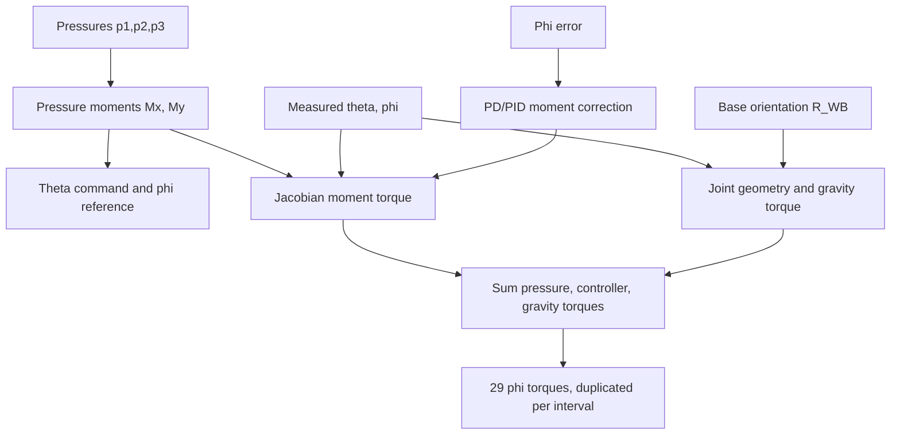

# Model Architecture

## Scope

This document describes the intended current architecture. Treat exact Simulink block names and connections as provisional until checked in the latest `.slx` models.

## Mechanical Discretization

The continuum module is represented by 30 disks connected by 29 rigid intervals. For interval `i`,

`T_i = Rz(theta) * Ry(phi/(2N)) * Tz(L/N) * Ry(phi/(2N)) * Rz(-theta)`.

The complete chain is the ordered product of all 29 interval transforms. The four revolute coordinates per interval are indexed as:

| Joint role | MATLAB index for interval `i` |
|---|---:|
| `+theta` | `1 + 4*(i-1)` |
| first `phi` | `2 + 4*(i-1)` |
| second `phi` | `3 + 4*(i-1)` |
| `-theta` | `4 + 4*(i-1)` |

## Intended Signal Flow

The measured Simscape signals and base rotation are delayed or sampled before entering calculations that feed torque back into the same physical network.

## Pressure-to-Moment Layer

For three equally spaced muscles,

`Mx = A*r*sqrt(3)*(p2-p3)/2`

`My = A*r*(p2+p3-2*p1)/2`

`M = sqrt(Mx^2 + My^2)`

`theta_cmd = atan2(-Mx, My)`

The nominal static continuum reference is `phi_ref = M/K`. At very small `M`, use the previous valid theta command.

## Torque Layers

The final torque should be kept decomposed for logging and debugging:

`tau_applied = tau_pressure + tau_feedback + tau_gravity_comp`.

- `tau_pressure`: `J.'*[Mx;My;0;0;0;0]` evaluated at the measured/delayed configuration.
- `tau_feedback`: Jacobian mapping of a PD/PID correction moment directed in the selected bending plane.
- `tau_gravity_comp`: negative of the generalized load caused by every downstream disk's weight.

For the temporary 29-output interface, select `tau(2 + 4*(i-1))` for interval `i` and send the result to both phi joints in that interval. Maintain a 58-value reference calculation for comparison.

## Coordinate Frames

| Symbol | Meaning |
|---|---|
| `W` | Simscape/world frame; gravity is `[0;0;-9.80665]` |
| `M` | Nominal Simscape module/base frame; undeformed module is horizontal |
| `K` | Kinematic base frame used by the rigid-link equations; undeformed backbone is `+z` |
| `R_WB` | Runtime base orientation input mapping module/base vectors into world coordinates |
| `R_MK` | Fixed mapping from kinematic coordinates to nominal Simscape module coordinates |

Use

`R_MK = [1 0 0; 0 0 1; 0 -1 0]`,

`R_WK = R_WB*R_MK`,

`g_K = R_WK.'*[0;0;-9.80665]`.

If `R_WB` already includes the fixed CAD/assembly alignment, do not multiply `R_MK` again. This must be established with the gravity sanity test in `VALIDATION_RESULTS.md`.

## Simulink/Simscape Interface

Expected MATLAB Function block inputs:

- pressure vector `p` (`3x1`, Pa)
- measured theta and phi (rad), delayed/sampled
- previous valid theta (rad) for the zero-moment singularity
- base orientation `R_WB` (`3x3`)
- optional PD/PID bending-moment correction (N·m)

Expected outputs:

- theta position command
- nominal/reference phi for logging/control
- 29 applied phi torques (N·m)
- separate 29-element pressure, feedback, and gravity torque components
- `Mx`, `My`, and moment magnitude
- optional pressure feasibility/saturation diagnostic

## Canonical Code Responsibilities

| File | Responsibility |
|---|---|
| `linkTransformation.m` | Per-interval homogeneous transform |
| `Jth_Jacobian.m` | Complete 6-by-`4N` Jacobian construction |
| `completeArm_Jacobian.m` | Public Jacobian wrapper |
| `pressure2force_moment_config.m` | Pressure-to-force, moment, theta, and phi relations |
| `estimateThetaPhi_CC.m` | Estimate constant-curvature variables from tip rotation |
| `Stiffness_cal.m` | Static pressure/moment/stiffness calculation |
| `Meeting_plots.m` | Inspect logged angle, pressure, and torque signals |
| `save_log_simulation.m` | Extract/save simulation log signals |

